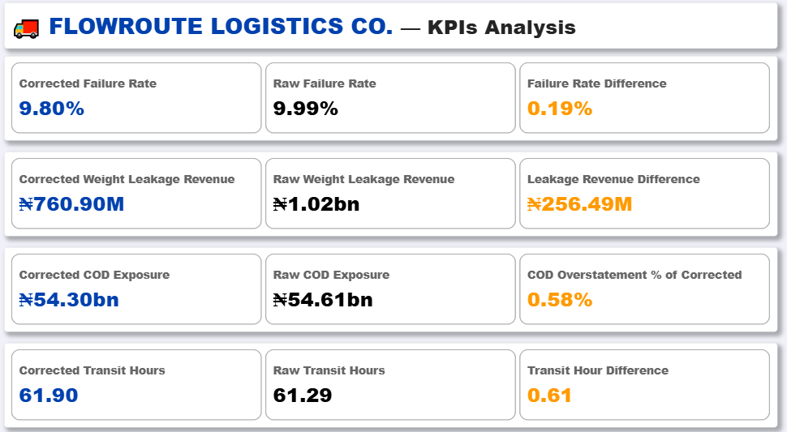
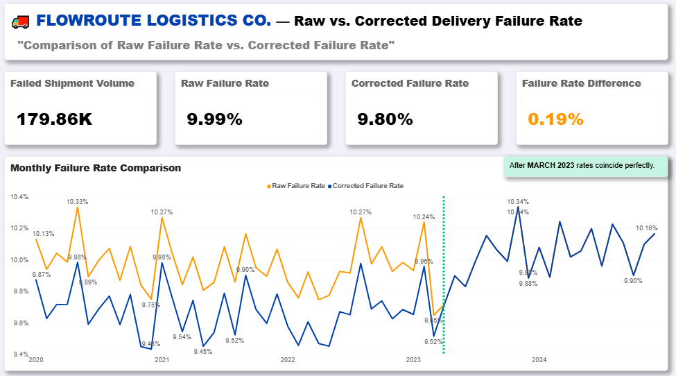
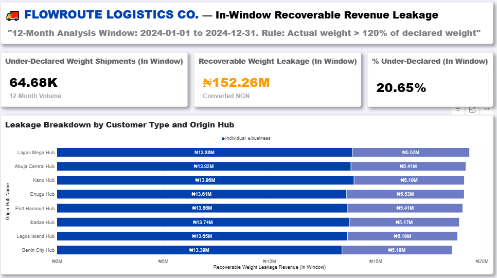
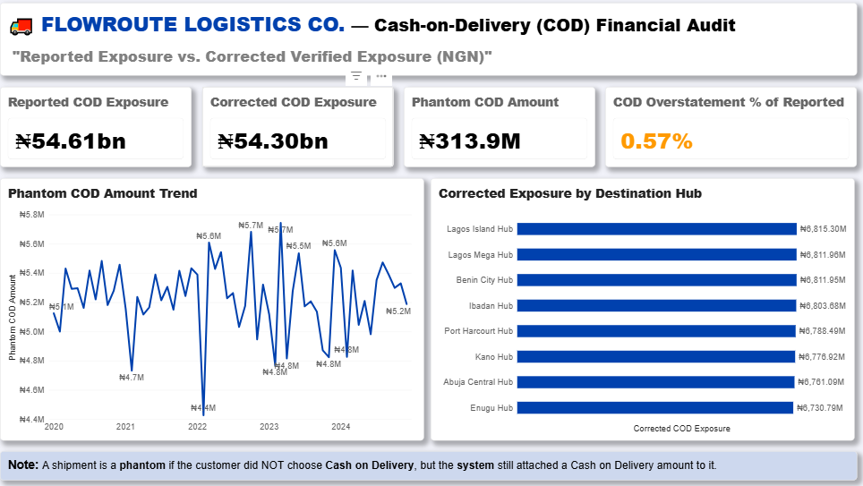
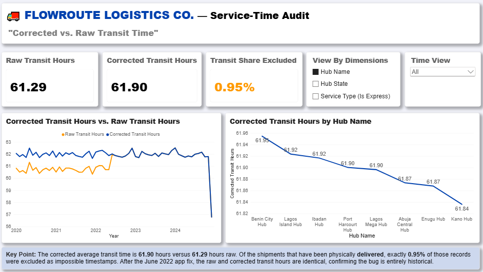

# FlowRoute Logistics: Operational Data Analysis

**SQL · Microsoft Excel · Power BI · PostgreSQL** | Data Analyst (simulated) | DataSimHQ | Logistics & Supply Chain

**Dataset:** 1.8M shipments · 12M tracking events · 8 hubs · 4,200 drivers · 2020 to 2024

> A delivery company said complaints were rising and could not tell whether the cause was a bad hub, delivery failures, financial leakage or inaccurate reporting. I tested each explanation, corrected four misleading system figures, and showed what the data does and does not prove.

## Results at a glance

- **Every complaint (64,737) sits on a failed or returned shipment.** About 30% of those shipments produce a complaint. Delivered and in-flight shipments produce none.
- **No hub, customer type or driver is an outlier.** Driver failure rates vary exactly as much as chance predicts, so the problem is systemic, not local.
- **The complaint "spike" is not supported by the data.** The rate has been about 36 per 1,000 shipments every year from 2020 to 2024.
- **The ~10% failure rate is real.** A software bug inflated it by only 0.19 pp.
- **The bigger risks sit in reporting:** 95% of "in-flight" shipments are over 90 days old, and 74% of delivered cash-on-delivery (COD) has no matching receipt.

| Metric | System figure | Adjusted | Type of adjustment | Reason |
|---|---:|---:|---|---|
| Failure rate | 9.99% | **9.80%** | Data error | 3,447 failed shipments affected by a retry bug |
| Recorded COD | ₦54.61bn | **₦54.30bn** | Data error | COD amounts on 62,254 non-COD shipments |
| Avg delivery time | 61.29 hrs | **61.90 hrs** | Data error | 12,335 records with delivery before pickup |
| Weight under-declaration | ₦1.02bn | **₦760.9M** | **Judgement** | >20% threshold; about ₦152M in the latest 12 months |

*Power BI board pack: corrected vs raw figures side by side.*

**Quick links:** [Key findings](#key-findings) · [Recommendations](#business-recommendations) · [Limitations](#limitations--assumptions) · [Reproduce](#how-to-reproduce) · [Full report](bussiness_insights_&_recommendations.pdf)

---

## Project overview

I investigated operational performance, customer complaints, data quality and potential financial leakage for FlowRoute Logistics, a simulated last-mile delivery company with eight hubs in Nigeria. Working through six stakeholder-led challenges, I used PostgreSQL, Excel and Power BI to test business assumptions, validate reported metrics and prepare recommendations.

**The central question was not just what the numbers showed, but whether management could trust them.**

**Business problem:** leadership could not tell whether rising complaints came from poor hub performance, delivery failures, financial leakage or inaccurate system reporting. The goal was to separate genuine operational problems from data-quality issues.

**Approach:** SQL investigation → Excel validation → Power BI reporting → business recommendations.

## Key findings

### 1. Customer complaints

*Power BI: complaint volume by category, year and month.*

- Total complaints: **64,737**, all linked to a failed (53,897) or returned (10,840) shipment. About 30% of those shipments generate a complaint.
- The four categories are split evenly (24.7% to 25.6%), so no category dominates. Lost is marginally largest at 25.57% (16,551).
- Hub complaint rates range from 35.7 to 36.5 per 1,000 shipments. About 65.1% of complaints were resolved.
- The annual complaint rate stayed around 36 per 1,000 shipments from 2020 to 2024.

**Insight:** no category or hub stands out. Focus on broader delivery and customer-service processes, not one location.

### 2. Hub and driver performance
- Delivery rates across the eight hubs range from 71.90% to 72.08%.
- Across 4,200 drivers, the spread of failure rates (1.45 pp) matches the spread expected by chance, and no driver outlier was found.

**Insight:** failures are not concentrated in a hub or driver. Look at network-wide processes, routes, shipment characteristics and tracking events.

### 3. Failure-rate correction

*Power BI: raw vs corrected failure rate and the retry-bug pattern.*

| Metric | Reported | Corrected |
|---|---:|---:|
| Failed shipments | 179,859 | 176,412 |
| Failure rate | 9.99% | **9.80%** |

- 3,447 failed shipments had delivery attempts above their permitted maximum. All had status `failed`, spread across hubs, from Jan 2020 to 14 Mar 2023.
- The correction assumes those shipments were not genuinely failed, so the defensible statement is a range of 9.80% to 9.99%.

**Insight:** the bug affected reporting only slightly. Failures remain close to 10% and are a real operational concern.

### 4. Shipment weight under-declaration

*Power BI: recoverable weight-leakage revenue by customer type and hub.*

**Rule:** under-declared when `actual weight > declared weight × 1.20`. Estimated shortfall = `shipping fee × (actual / declared − 1)`, converted from kobo to naira.

| Metric | Result |
|---|---:|
| Shipments over the 20% threshold (all-time) | 323,752 |
| Shortfall before applying the threshold | ₦1.02bn |
| Shortfall after applying the threshold | **₦760.9M** |
| Latest 12 months (>20% tier) | 64,673 shipments, **₦152.25M** |

- Individual and business accounts under-declare at similar rates (20.72% vs 20.66%) with similar shortfall per parcel. Individuals account for more of the total only because they ship more.

**Insight:** business customers are not worse than individuals, so strengthen weight verification for everyone. The 20% threshold is my assumption, intended to exclude scale and packaging variation. It does not prove the excluded differences are harmless.

### 5. Cash-on-delivery data quality

*Power BI: reported vs corrected COD exposure.*

- 62,254 shipments with a non-COD payment method carried a COD amount, worth about **₦313.9M** (0.58%). Reported COD ₦54.61bn becomes **₦54.30bn** after exclusion.
- About 74% of delivered COD shipments have no completed `cod_cash` payment record (about ₦36.6bn of recorded COD amounts). This needs reconciliation. It is **not confirmed missing cash**.

**Insight:** reconcile COD amounts against payment and cash-receipt records before treating any figure as a confirmed loss.

### 6. Delivery time and timestamp quality

*Power BI: raw vs corrected transit hours by year and hub.*

| Metric | Reported | Adjusted |
|---|---:|---:|
| Average delivery time | 61.29 hrs | **61.90 hrs** |
| Median delivery time | n/a | **61.86 hrs** |

- 12,335 delivered shipments had delivery before pickup (records up to 2 Jun 2022), and were excluded. 99.05% of delivered shipments remain.
- Hub averages range from 61.87 to 61.94 hours.
- Against an assumed 72-hour benchmark, 58.7% of valid delivered shipments arrived on time.
- The negative times run from 1 to 12 hours. A timezone issue was suggested but is not independently confirmed.

**Insight:** validate timestamps before using delivery-time metrics. The 72-hour benchmark is my assumption, not company policy.

### 7. Additional data-quality checks
- **Missing coordinates:** 360,509 shipments (about 20%). Failure rate is 10.00% with coordinates and 9.95% without, so no measurable effect.
- **Stuck in-flight shipments:** 256,625 (95% of in-flight) are over 90 days old, with about ₦7.75bn in recorded COD amounts. They produce no complaints, so they are a status-reporting and reconciliation risk.

## Business recommendations

| Priority | Recommendation | Evidence | Intended outcome |
|---|---|---|---|
| 1 | Reconcile delivered COD against completed cash receipts | 74% of delivered COD shipments lack a completed cash payment record | Establish the actual cash position |
| 2 | Reduce failed and returned deliveries, and contact customers when a delivery fails | All complaints sit on failed or returned shipments | Fewer complaints |
| 3 | Investigate why deliveries fail (shipment type, routes, tracking events) | Failure is uniform at about 10% and not explained by hub, driver, customer or coordinates | Find the operational cause |
| 4 | Close out in-flight shipments over 90 days | 256,625 shipments | Accurate status and financial visibility |
| 5 | Automate weight verification and fee adjustment | About ₦152.25M estimated in the latest 12-month window | Reduce undercharging |
| 6 | Block COD amounts on non-COD shipments | 62,254 inconsistent records | Accurate financial reporting |
| 7 | Validate delivery attempts and timestamps at entry | Retry anomalies and 12,335 invalid transit records | Reliable KPIs |

## How to reproduce

1. Get access to the simulated dataset through [DataSimHQ](https://datasimhq.com/) and connect to the `logistics` schema in PostgreSQL.
2. Read `data/README.md` and the data dictionary.
3. Run the scripts in `sql/` in numbered order.
4. Open `powerbi/flowroute_dashboard.pbix`, set the data source and refresh.
5. Open the Excel workbook in `excel/` for supporting calculations and cross-checks.

**Validation checkpoints**

| Check | Expected |
|---|---:|
| Total complaints | 64,737 |
| Raw / corrected failed shipments | 179,859 / 176,412 |
| Shipments over 20% above declared weight | 323,752 |
| Non-COD shipments with a COD amount | 62,254 |
| Valid delivered shipments in the transit average | 1,283,555 |

Money is stored in kobo and converted to naira (÷100) for reporting.

## Limitations & assumptions

- This is a simulated case study from DataSimHQ, not a live engagement. The raw data belongs to DataSimHQ and is not included.
- **The cause of delivery failures is not yet established.** Shipment characteristics, routes and tracking events were not analysed.
- The 20% weight threshold and the over-cap failure correction are assumptions.
- The timezone explanation for negative transit times is unverified.
- Estimated recoverable fees are not confirmed collections.
- **Excel files use samples or shorter time windows.** Board figures come from SQL and Power BI on the full data.
- Cross-tool reconciliation raises confidence in calculations but does not prove every source record is accurate.

## What this project demonstrates

| Skill | Evidence |
|---|---|
| SQL | Joins, CTEs, window functions, filtered aggregates, conditional calculations |
| Data quality analysis | Retry anomalies, inconsistent COD fields, invalid timestamps |
| Financial analysis | Fee shortfall, COD reconciliation, kobo to naira conversion |
| Statistical thinking | Rate comparisons, normalisation, driver variation tested against chance |
| Excel and Power BI | Cross-tool validation, KPI dashboards, management reporting |
| Business communication | Findings, recommendations and limitations written for stakeholders |
| Critical thinking | Tested hypotheses, rejected several, separated data errors from judgement calls |

**My approach:** validate the data, test the assumptions, explain the findings, support better decisions.

---

**Connect:** [LinkedIn](https://www.linkedin.com/in/sumaya-mateen/) · [GitHub](https://github.com/sumayamateen)
