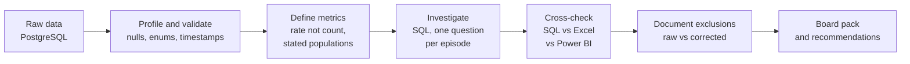
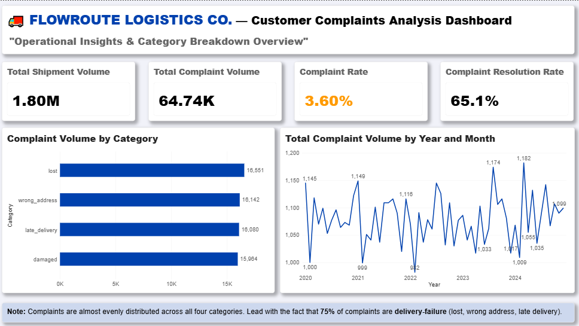

# FlowRoute Logistics: Operational Data Analysis

**Role simulated:** Data Analyst · **Tools:** PostgreSQL, Power BI, Excel · **Scale:** 1.8M shipments, 8 hubs, 5 years of data

> I investigated why a last-mile delivery company's complaints were rising, found which "problems" were data errors and which were real, and produced a board pack of corrected figures with every correction justified.

**Quick links:** [Executive summary](#executive-summary) · [Key findings](#key-findings) · [Workflow](#workflow) · [Dashboard previews](#dashboard-previews) · [Recommendations](#recommendations) · [Limitations](#limitations-and-open-items) · [Reproduce](#how-to-reproduce) · [Report](reports/findings_summary.md)

---

## 1. Project overview

FlowRoute Logistics Co. is a simulated Nigerian last-mile delivery network (8 hubs, 3,000+ drivers). The project was completed on the DataSimHQ analyst simulation platform as six client "episodes", each requested by a different stakeholder (COO, Head of CX, Financial Controller, Head of Data). The data is simulated.

## 2. Business problem

Complaints had risen for three months, and the board wanted answers. Leadership could not tell whether the cause was a real operational failure, a specific hub, financial leakage, or errors in the data itself.

## 3. Objectives

| # | Stakeholder question | What I had to deliver |
|---|---|---|
| 1 | How big is the complaint problem, and where? | Complaint volumes by category and hub |
| 2 | Is the reported failure rate real? | Failure rate corrected for an app defect, with the defect dated and sized |
| 3 | How much revenue is lost to under-declared weights, and who causes it? | Leakage in naira, split by customer type and hub |
| 4 | What is the real cash-on-delivery (COD) position? | Audit figure reconciled to the data |
| 5 | What delivery-time figure can the board trust? | Average and median transit time with documented exclusions |
| 6 | Put it together | Raw vs corrected figures, with the reason for each correction |

## 4. Dataset

PostgreSQL schema `logistics` with 11 objects (9 tables, 2 views). Money is stored in kobo (÷100 for naira).

| Table | Content | Rows (approx.) |
|---|---|---|
| `shipments` | Shipment, fee, weight, COD, attempts, timestamps | 1.8M |
| `tracking_events` | Scan and status events | 12M |
| `complaints` | Category, status, resolution date | 64,737 |
| `payments`, `routes`, `drivers`, `hubs`, `customers`, `delivery_addresses` | Supporting dimensions | n/a |
| `v_shipment_performance`, `v_hub_performance` | Provided summary views | n/a |

**Raw data is not included in this repository** (it belongs to DataSimHQ). See [`data/README.md`](data/README.md) for how to obtain it.

**Data issues found:** the data dictionary does not match the real data. Shipment statuses `created`, `out_for_delivery` and `cancelled` exist but are undocumented, and `pending` and `picked_up` do not exist. Payment methods `credit` and `wallet` are also undocumented.

## 5. Workflow

Key analytical decisions made along the way:

- **Normalised before comparing.** Compared rates (complaints per 1,000, % under-declared, ₦ per parcel), not totals, so large groups were not blamed for their volume.
- **Reconciled three tools.** Every headline figure was computed in SQL, Excel and Power BI, and the differences were investigated (time windows, timezones, sample vs population).
- **Separated data errors from judgement calls.** Three corrections remove records that cannot be right. The weight correction depends on a threshold I chose, so both tiers are shown.
- **Stated the population for every metric** (all shipments vs delivered only; all-time vs 12 months).

## Executive summary

Four system figures were corrected, and the corrections are small. The failure rate of about 10% is real, not a software artefact. **No hub, complaint category or customer type is an outlier in any analysis, so the problems are systemic and need process and system fixes, not action against particular sites or customer groups.** The larger risks are data and process gaps that the raw reports do not show: parcels stuck "in flight" for months, and delivered COD with no matching cash receipt.

## Key findings

| Area | Raw system | Adjusted | Difference | Type of adjustment | Reason |
|---|---|---|---|---|---|
| Failure rate (all shipments) | 9.99% | **9.80%** | 0.19 pp | Data error | App let delivery attempts exceed policy on 3,447 failed shipments (Jan 2020 to 14 Mar 2023) |
| Weight under-declaration (all-time) | ₦1,017.4M | **₦760.9M** (>20% over declared) | ₦256.5M | Judgement (threshold) | Excludes excesses of 20% or less as possible scale tolerance; **not proven to be noise** |
| Recorded COD amounts | ₦54.61bn | **₦54.30bn** | ₦313.9M (0.58%) | Data error | 62,254 non-COD shipments carry a COD amount of about ₦5,000 each |
| Average delivery time (delivered only) | 61.29 hrs | **61.90 hrs** (median 61.86) | 0.61 hrs | Data error | 12,335 delivered shipments have delivery before pickup (to 2 Jun 2022); 99.05% of delivered shipments included |

Supporting results:

- **Complaints:** 64,737 total, **all on failed or returned shipments** (about 30% of those shipments complain). The rate is steady at about 36 per 1,000 shipments every year, hubs sit at 35.7 to 36.5, and categories split evenly (24.7% to 25.6%). 65.1% were resolved.
- **Drivers:** 4,200 drivers; the spread of failure rates equals what chance predicts (1.45 pp), so no driver is measurably worse.
- **Weight leakage, last 12 months:** 64,673 shipments over 20% above declared weight, ₦152.25M. Business and individual accounts behave the same (about 20.7% and about ₦2,350 per parcel), so the hypothesis that business accounts were the cause is rejected.
- **Failure bug:** 100% of the 3,447 affected shipments are `failed`, spread evenly across hubs. Correcting for it moves the rate by only 0.19 pp.
- **Missing delivery-address coordinates:** 20% of shipments (360,509). Failure rate is 10.00% with coordinates and 9.95% without, so there is no measurable service impact.
- **Transit time:** hub averages range 61.87 to 61.94 hrs. Against a 72-hour benchmark (my assumption), 58.7% of valid delivered shipments arrive on time.
- **Negative transit times** are 1 to 12 hours, larger than a UK/Lagos clock difference, so the "timezone" explanation given by the client is plausible but **not independently confirmed**.

## Dashboard previews

> Add your screenshots to `screenshots/` using these names, then keep the lines below.

| Complaints (Ep 1) | Failure-rate correction (Ep 2) |
|---|---|
|  |  |

| Weight leakage (Ep 3) | COD reconciliation (Ep 4) |
|---|---|
|  |  |

| Transit time (Ep 5) | Board pack KPIs (Ep 6) |
|---|---|
|  |  |

## Recommendations

| Priority | Action | Evidence | Expected effect |
|---|---|---|---|
| 1 | Reconcile delivered COD against cash receipts | 74% of delivered COD parcels have no completed `cod_cash` payment (₦36.6bn recorded amount, not confirmed as missing cash) | Confirms whether this is a recording gap or a cash-control problem |
| 2 | Close out or investigate stuck shipments | 256,625 shipments (95% of in-flight) are over 90 days old, worth ₦7.75bn in COD amounts | Cleaner status data; these shipments produce no complaints, so this is a reporting and cash risk |
| 3 | Re-bill weight differences automatically at the hub scale | About ₦152M a year on parcels over 20% above declared weight, at a steady rate | Illustrative recovery of ₦38M to ₦114M a year at 25% to 75% recovery |
| 4 | Block COD amounts on non-COD shipments at data entry | About 1,000 shipments a month since Jan 2020, still occurring | Removes the ₦313.9M overstatement in audit reports |
| 5 | Fix timestamp capture and update the data dictionary | 12,335 impossible transit records; undocumented enums | Trustworthy service-time reporting |

Scenario revenue impact (illustrative): **₦40.0M / ₦81.1M / ₦124.1M a year** (cautious / expected / ambitious). Recovery rates and failure-rate cuts are assumptions, not forecasts. The failure lever uses the 2024 average fee on failed shipments (₦2,754, 36,255 failures).

## Limitations and open items

I list these so no reader has to find them:

- **The cause of failed deliveries is unknown.** Hubs, customer type, coordinates and drivers are rejected. Shipment characteristics, routes and tracking events were not analysed.
- **The monthly complaint rate was calculated by hand** (about 36 per 1,000 in every year), so a SQL check would confirm that there is no spike.
- **COD receipt gap is unresolved.** I did not finish checking what payments exist for delivered COD parcels, so I cannot say whether the ₦36.6bn is a recording gap or a cash problem.
- **The 3,447 over-cap failures** were removed on the assumption they are not genuine failures. The range 9.80% to 9.99% is the defensible statement.
- **The >20% weight threshold** is a judgement. I did not test it against smaller excesses.
- **The 72-hour SLA** is an assumption, not a client-stated target.
- **Excel files use sample extracts.** Board figures come from SQL on the full data.
- **The cause of negative transit times** is unconfirmed.

| Check | Expected |
|---|---|
| Total complaints | 64,737 |
| Failed shipments (raw / corrected) | 179,859 / 176,412 |
| Shipments over 20% above declared weight | 323,752 |
| Phantom COD shipments | 62,254 |
| Valid delivered shipments in transit average | 1,283,555 |

4. **Power BI:** open `powerbi/flowroute_dashboard.pbix`, point the data source to your connection, and refresh. All measures are also in `powerbi/measures.dax`.
5. **Excel:** the workbook holds extracts for demonstration. Board figures are pasted from SQL as values, with sources noted.

Conventions used throughout: money converted from kobo to naira; "pp" means percentage points; every figure states its window and population.

## What this project demonstrates

| Skill | Where to see it |
|---|---|
| Rate vs volume thinking, normalisation | Complaints per 1,000; leakage per shipment by customer type |
| SQL: CTEs, window functions, filtered aggregates, percentiles | `sql/02`, `sql/04`, `sql/05` |
| Data validation and reconciliation across tools | Failure-rate, weight and COD figures matched in SQL, Excel and Power BI |
| Documenting analytical decisions | Exclusion rules and correction type in the Key findings table |
| Business communication | Executive summary, recommendations, limitations |

